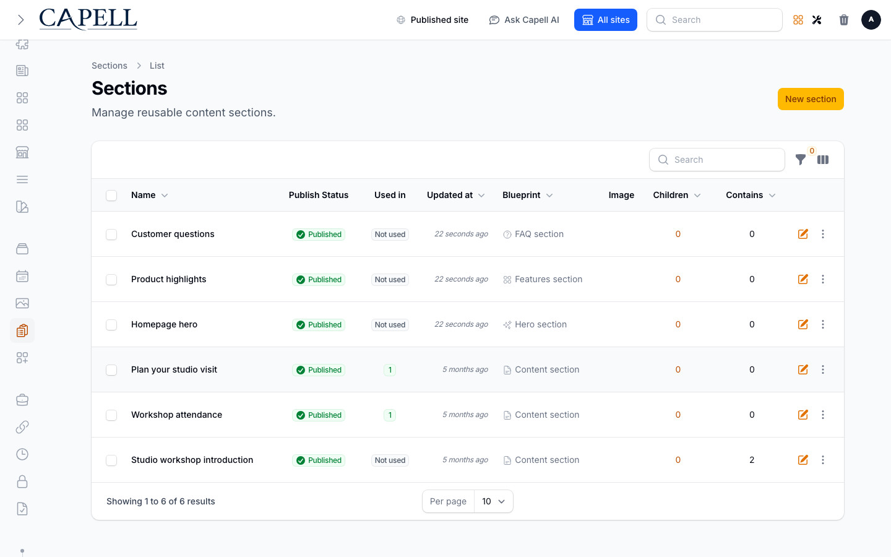
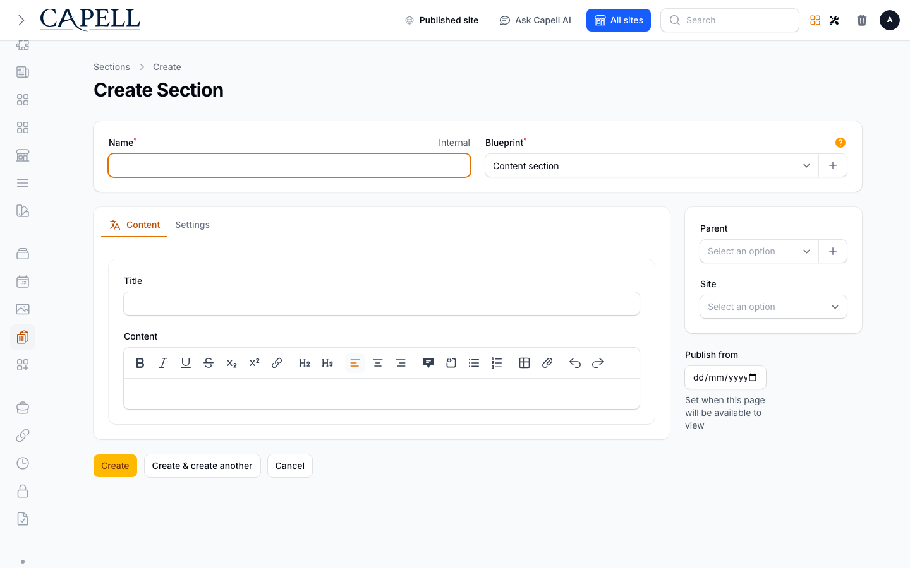

# Content Sections

<!-- prettier-ignore-start -->

## What It Does

Content Sections adds reusable, publishable section records backed by registered blueprints and package-owned rendering components.

- **Price and availability:** Check current availability and price on the [Capell Marketplace listing](https://capell.app/extensions/content-sections).
- **Licence:** Check the licence terms on the [Capell Marketplace listing](https://capell.app/extensions/content-sections).
- **Requires:** `PHP ^8.4`, `capell-app/admin ^1.0.66`, `capell-app/block-library ^1.0`, `capell-app/core ^1.0.75`, `capell-app/frontend ^1.0.70`, `capell-app/layout-builder ^1.0.50`, `capell-app/theme-foundation ^1.0`, `symfony/html-sanitizer ^7.0 || ^8.0`.
- **Install:** `composer require capell-app/content-sections`.

Editors create and publish shared sections in the admin and select them from other content surfaces; public pages receive the rendered section without admin metadata.

## Who It Is For

**For developers:** Section definitions are registered through a provider contract and resolved by Actions, so new section types can be added without placing queries or presentation logic in public views.

**For teams:** Teams can maintain repeated content in one section and reuse it across pages while preserving a controlled publishing workflow.

## Quick Start

1. Install the package: `composer require capell-app/content-sections`.
2. Open the package admin surface at `/admin/content-sections/sections` and confirm Content Sections is available.

## Configure

- **Configuration files:** `config/capell-content-sections.php`.

## Limits And Pitfalls

- Install the required Capell packages at the versions in `composer.json`: `capell-app/admin ^1.0.66`, `capell-app/block-library ^1.0`, `capell-app/core ^1.0.75`, `capell-app/frontend ^1.0.70`, `capell-app/layout-builder ^1.0.50`, `capell-app/theme-foundation ^1.0`.
- Run migrations before opening package resources or public routes.
- Review middleware, throttling, signatures, and public-output safety in `routes/web.php` before exposing routes.
- Keep public Blade and cached HTML free of authoring markers, model IDs, permissions, signed editor URLs, and lazy database queries.
- Custom write integrations must preserve invalidation for `content-sections` cache tags.

## Screens And Workflow

- Reusable sections index (admin).
- Create reusable section form (admin).
- Edit reusable section with assets (admin).
- Section selector modal (frontend).
- Frontend section widget gallery (frontend).
- Reusable sections index with admin sidebar menu open (admin).

## Install Impact

- Required packages: `capell-app/admin`, `capell-app/block-library`, `capell-app/core`, `capell-app/frontend`, `capell-app/layout-builder`, `capell-app/theme-foundation`.
- Admin navigation: declares `admin-resource: ContentSectionsPackageContribution`; each Filament page or resource controls its own navigation visibility.
- Admin/editor extensions: `configurator: ContentSectionsPackageContribution`, `schema-extender: ContentSectionsSchemaExtendersContribution`.
- Permissions: `ViewAny:Section`, `View:Section`, `Create:Section`, `Update:Section`, `Delete:Section`, `DeleteAny:Section`, `Restore:Section`, `RestoreAny:Section`, `ForceDelete:Section`, `ForceDeleteAny:Section`, `Replicate:Section`, `Reorder:Section`; access also governed by package policies: `SectionAssetAttachmentPolicy`, `SectionPolicy`.
- Public routes: loads `routes/web.php`; registers `ContentSectionsRoutesContribution`, `PublicSectionFragmentsRoutesContribution`.
- Database changes: package migrations are declared.
- Config: `config/capell-content-sections.php`.
- Settings: no package settings declared.
- Queues or schedules: none declared.
- Cache tags: `content-sections`.
- Commands: none declared.

## Troubleshooting

| Symptom | Likely cause | Check | Fix |
| --- | --- | --- | --- |
| Package surface is missing after install | Provider or manifest is not loaded | Confirm `capell.json`, package `composer.json`, and provider registration | Reinstall the package, refresh Composer autoload, and clear host caches |
| Admin screen or command fails on missing table | Package migrations have not run | Check the tables listed in `Data Model` | Run host migrations and rerun the focused package test |
| Route returns unexpected output | Route cache, middleware, or signed URL setup does not match the package route file | Check the route files listed in `Technical Shape` | Clear route cache and verify middleware before exposing public routes |
| Public output leaks unexpected state | Render data, cache variation, or authoring boundary has regressed | Check public Blade, cache tags, and public-output safety tests | Move data loading out of Blade and rerun the package public-output tests |

## Upgrading

No manual steps between minor versions.

Read [CHANGELOG.md](CHANGELOG.md) before upgrading.

## Next Steps

- [Package docs](docs/README.md)
- [Overview](docs/overview.md)
- [Worked extension examples](docs/extension-contracts.md)
- [Admin guide](docs/admin-guide.md)
- Configuration files: [`config/capell-content-sections.php`](config/capell-content-sections.php).
- [Troubleshooting](#troubleshooting)
- [Developer reference](docs/reference.md)
- [Marketplace assets](docs/assets/marketplace/)
- [Capell content language plan](../../docs/CONTENT_LANGUAGE_PLAN.md)
- [Capell documentation design system](../../docs/DESIGN_SYSTEM.md)
- [Capell and package ERD notes](../../docs/erd/capell-and-package-erds.md)
- Related packages: [Block Library](../block-library/README.md), [Layout Builder](../layout-builder/README.md), [Foundation Theme](../theme-foundation/README.md), [Publishing Studio](../publishing-studio/README.md), [Public Actions](../public-actions/README.md).

<!-- prettier-ignore-end -->
